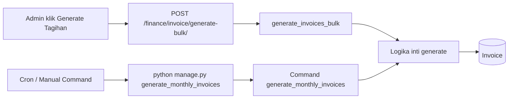
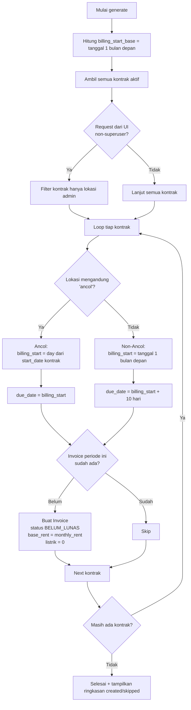
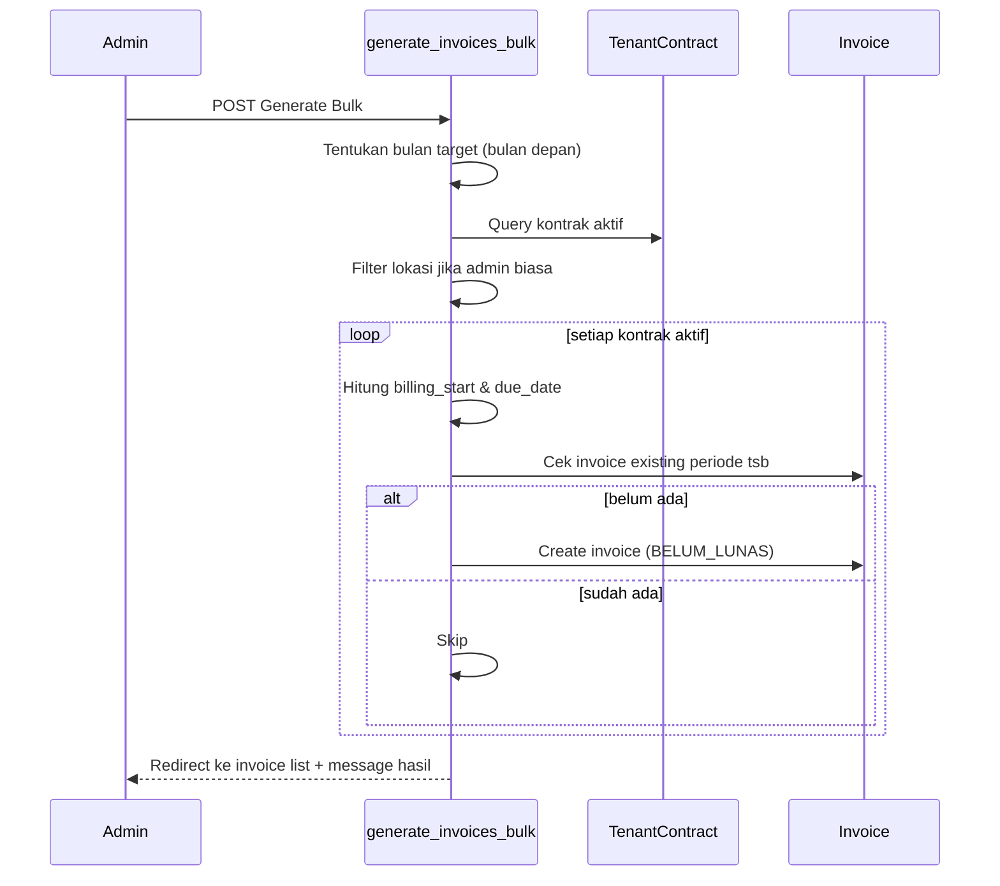
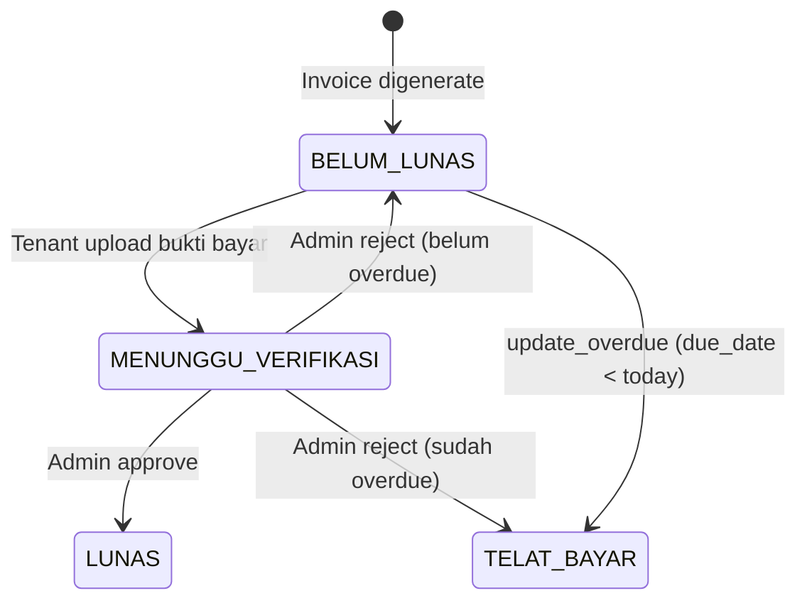
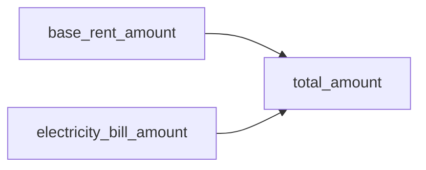

# Visual Skema Generate Tagihan

## 1) Arsitektur Jalur Generate

## 2) Alur Inti Generate (Business Rules)

## 3) Sequence Diagram (UI Generate Bulk)

## 4) Lifecycle Status Tagihan

## 5) Rumus Nilai Tagihan

Keterangan:
- total_amount selalu dihitung ulang saat save invoice.
- electricity_bill_amount diupdate dari input meter listrik di detail invoice.

## 6) Catatan Implementasi Penting

- Anti-duplikasi: invoice tidak dibuat jika kontrak + periode billing sudah ada.
- Rule lokasi:
  - Superuser bisa generate semua lokasi.
  - Admin biasa hanya lokasi assignment-nya.
- Perbedaan rule:
  - Ancol = siklus per tenant (mengikuti tanggal mulai kontrak).
  - Non-Ancol = serentak tanggal 1, jatuh tempo H+10.
