# RENCANA SIMULASI PROSES BISNIS PENUH
## Evy Kost Management System — Full End-to-End Testing Plan

> **Tanggal:** 26 Februari 2026  
> **Versi:** 1.0  
> **Cakupan:** Seluruh 45 fitur tanpa terkecuali  

---

## DAFTAR ISI

1. [Inventaris Fitur Lengkap](#1-inventaris-fitur-lengkap)
2. [Aktor & Peran](#2-aktor--peran)
3. [Skema Data Simulasi](#3-skema-data-simulasi)
4. [Flowchart Utama — End-to-End](#4-flowchart-utama--end-to-end)
5. [BPMN Diagram Per Modul](#5-bpmn-diagram-per-modul)
6. [State Diagram — Invoice Lifecycle](#6-state-diagram--invoice-lifecycle)
7. [State Diagram — Maintenance Ticket](#7-state-diagram--maintenance-ticket)
8. [Rencana Simulasi Per Fase](#8-rencana-simulasi-per-fase)
9. [Matriks Test Case Lengkap](#9-matriks-test-case-lengkap)
10. [Sequence Diagram — Alur Kritis](#10-sequence-diagram--alur-kritis)

---

## 1. INVENTARIS FITUR LENGKAP

### 1.1 Portal Publik (Tanpa Login — Session-Based via PIN)

| No | URL | Method | Fitur | View |
| -- | --- | ------ | ----- | ---- |
| F-01 | `/` | GET | Landing Page | `home` |
| F-02 | `/bayar/` | GET/POST | Validasi PIN Penghuni | `public_payment_step1` |
| F-03 | `/bayar/upload/` | GET/POST | Upload Bukti Pembayaran | `public_payment_step2` |
| F-04 | `/bayar/riwayat/` | GET | Riwayat Pembayaran Penghuni | `public_payment_history` |
| F-05 | `/bayar/keluar/` | GET | Logout Portal Publik | `public_logout` |
| F-06 | `/lapor/` | GET/POST | Buat Laporan Kerusakan | `public_report_create` |
| F-07 | `/lapor/riwayat/` | GET | Riwayat Laporan Kerusakan | `public_report_list` |

### 1.2 Autentikasi & Akun

| No | URL | Method | Fitur | View |
| -- | --- | ------ | ----- | ---- |
| F-08 | `/accounts/login/` | GET/POST | Login Admin | `LoginView` |
| F-09 | `/accounts/logout/` | POST | Logout Admin | `LogoutView` |
| F-10 | `/accounts/password_change/` | GET/POST | Ganti Password | `PasswordChangeView` |
| F-11 | `/accounts/password_change/done/` | GET | Konfirmasi Ganti Password | `PasswordChangeDoneView` |

### 1.3 Dashboard

| No | URL | Method | Fitur | View |
| -- | --- | ------ | ----- | ---- |
| F-12 | `/staff/dashboard/` | GET | Dashboard Admin (KPI + Peta Visual + Tabel Perhatian) | `admin_dashboard` |

### 1.4 Manajemen Lokasi

| No | URL | Method | Fitur | View |
| -- | --- | ------ | ----- | ---- |
| F-13 | `/staff/settings/locations/` | GET | Daftar Lokasi (Superuser) / Redirect (Admin) | `location_list` |
| F-14 | `/staff/settings/locations/<pk>/edit/` | GET/POST | Edit Lokasi & Tarif Listrik | `location_update` |

### 1.5 Manajemen Kamar

| No | URL | Method | Fitur | View |
| -- | --- | ------ | ----- | ---- |
| F-15 | `/staff/rooms/` | GET | Daftar Kamar + Status Okupansi | `room_list` |
| F-16 | `/staff/rooms/add/` | GET/POST | Tambah Kamar | `room_create` |
| F-17 | `/staff/rooms/<pk>/edit/` | GET/POST | Edit Kamar | `room_update` |
| F-18 | `/staff/rooms/<pk>/delete/` | POST | Hapus Kamar (Hanya jika kosong) | `room_delete` |

### 1.6 Manajemen Penghuni

| No | URL | Method | Fitur | View |
| -- | --- | ------ | ----- | ---- |
| F-19 | `/staff/tenants/` | GET | Daftar Penghuni (Search + Pagination + KPI) | `tenant_list` |
| F-20 | `/staff/tenants/add/` | GET/POST | Tambah Penghuni | `TenantCreateView` |
| F-21 | `/staff/tenants/<pk>/edit/` | GET/POST | Edit Penghuni | `TenantUpdateView` |
| F-22 | `/staff/tenants/<pk>/assign/` | GET/POST | Assign Kamar (Buat Kontrak) | `TenantContractCreateView` |
| F-23 | `/staff/tenants/<pk>/checkout/` | POST | Checkout Penghuni | `tenant_checkout` |
| F-24 | `/staff/tenants/<pk>/delete/` | POST | Hapus Data Penghuni | `tenant_delete` |

### 1.7 Manajemen Tagihan

| No | URL | Method | Fitur | View |
| -- | --- | ------ | ----- | ---- |
| F-25 | `/invoice/` | GET | Daftar Tagihan (Filter + Search + Pagination) | `invoice_list` |
| F-26 | `/invoice/<pk>/` | GET/POST | Detail Tagihan + Input Listrik | `invoice_detail` |
| F-27 | `/invoice/<pk>/print/` | GET | Cetak Kwitansi (Hanya LUNAS) | `print_receipt` |
| F-28 | `/invoice/generate-bulk/` | POST | Generate Tagihan Massal | `generate_invoices_bulk` |

### 1.8 Verifikasi Pembayaran

| No | URL | Method | Fitur | View |
| -- | --- | ------ | ----- | ---- |
| F-29 | `/verify/<id>/approve/` | POST | Approve Pembayaran | `verify_payment` |
| F-30 | `/verify/<id>/reject/` | POST | Reject Pembayaran | `verify_payment` |

### 1.9 Biaya Operasional

| No | URL | Method | Fitur | View |
| -- | --- | ------ | ----- | ---- |
| F-31 | `/operation/` | GET | Daftar Biaya Operasional | `operation_list` |
| F-32 | `/operation/add/` | GET/POST | Catat Pengeluaran Baru | `operation_create` |
| F-33 | `/operation/<pk>/edit/` | GET/POST | Edit Pengeluaran | `operation_update` |
| F-34 | `/operation/<pk>/delete/` | POST | Hapus Pengeluaran | `operation_delete` |

### 1.10 Maintenance Ticket (Admin Side)

| No | URL | Method | Fitur | View |
| -- | --- | ------ | ----- | ---- |
| F-35 | `/tickets/` | GET | Daftar Tiket Maintenance (Filter Status + Kamar) | `admin_ticket_list` |
| F-36 | `/tickets/<pk>/update/` | GET/POST | Update Status Tiket | `admin_ticket_update` |

### 1.11 Laporan Keuangan

| No | URL | Method | Fitur | View |
| -- | --- | ------ | ----- | ---- |
| F-37 | `/report/` | GET | Dashboard Laporan (Multi-Chart) | `finance_report` |
| F-38 | `/report/export/` | GET | Export Laporan Excel (.xlsx) | `export_finance_excel` |

### 1.12 Manajemen Staff (Superuser Only)

| No | URL | Method | Fitur | View |
| -- | --- | ------ | ----- | ---- |
| F-39 | `/management/staff/` | GET | Daftar Staff Admin Kost | `staff_list` |
| F-40 | `/management/staff/add/` | GET/POST | Tambah Staff Baru | `staff_create` |
| F-41 | `/management/staff/<pk>/edit/` | GET/POST | Edit Staff | `staff_update` |

### 1.13 Management Commands

| No | Command | Fitur |
| -- | ------- | ----- |
| F-42 | `python manage.py seed_data` | Isi Database dengan Data Dummy |
| F-43 | `python manage.py generate_monthly_invoices` | Generate Tagihan Bulan Depan |
| F-44 | `python manage.py update_overdue` | Update Status Tagihan Telat |

### 1.14 Infrastruktur

| No | URL/File | Fitur |
| -- | -------- | ----- |
| F-45 | `/health/` | Health Check + DB Connection |
| F-46 | `/admin/` | Django Admin Panel |
| F-47 | `Dockerfile` | Container Deployment |

**Total: 47 fitur teridentifikasi.**

---

## 2. AKTOR & PERAN

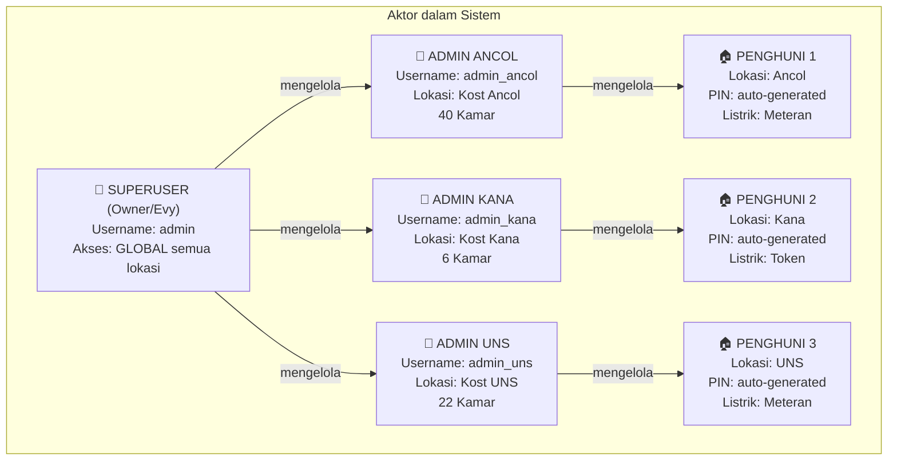

### Matriks Hak Akses

| Fitur | Superuser | Admin Biasa | Penghuni (PIN) |
| ----- | --------- | ----------- | -------------- |
| Dashboard | ✅ Semua lokasi + filter | ✅ Hanya lokasinya | ❌ |
| Kelola Lokasi | ✅ Lihat list semua | ✅ Edit lokasinya saja | ❌ |
| Kelola Kamar | ✅ Semua kamar | ✅ Kamar di lokasinya | ❌ |
| Kelola Penghuni | ✅ Semua penghuni | ✅ Penghuni lokasinya | ❌ |
| Tagihan | ✅ Semua tagihan | ✅ Tagihan lokasinya | ✅ Riwayat sendiri |
| Verifikasi Bayar | ✅ Semua | ✅ Hanya lokasinya | ❌ |
| Biaya Operasional | ✅ Semua | ✅ Lokasinya | ❌ |
| Maintenance Ticket | ✅ Semua | ✅ Lokasinya | ✅ Buat + Lihat sendiri |
| Laporan Keuangan | ✅ Filter lokasi | ✅ Lokasinya saja | ❌ |
| Kelola Staff | ✅ Full CRUD | ❌ | ❌ |
| Bayar (Upload Bukti) | ❌ | ❌ | ✅ |
| Ganti Password | ✅ | ✅ | ❌ |

---

## 3. SKEMA DATA SIMULASI

### 3.1 Data Lokasi
```
┌─────────────┬─────────────────────────┬──────────────┬────────────────┐
│ Lokasi      │ Alamat                  │ Tarif/KWH    │ Jumlah Kamar   │
├─────────────┼─────────────────────────┼──────────────┼────────────────┤
│ Kost Ancol  │ Jl. Pasir Putih, Ancol  │ Rp 1.500     │ 40 kamar       │
│ Kost Kana   │ Jl. Dago Pakar, Bandung │ Rp 1.700     │ 6 kamar        │
│ Kost UNS    │ Jl. Ir Sutami, Solo     │ Rp 1.300     │ 22 kamar       │
└─────────────┴─────────────────────────┴──────────────┴────────────────┘
```

### 3.2 Data Test Penghuni (Simulasi Manual)

| No | Nama | Lokasi | Kamar | Harga/Bulan | Tipe Listrik | Skenario Test |
| -- | ---- | ------ | ----- | ----------- | ------------ | ------------- |
| 1 | Budi Santoso | Ancol | A-101 | Rp 1.500.000 | Meteran | Happy path pembayaran |
| 2 | Siti Rahayu | Ancol | A-102 | Rp 2.000.000 | Meteran | Pembayaran ditolak → bayar ulang |
| 3 | Ahmad Fauzi | Kana | K-101 | Rp 1.500.000 | Token | Checkout flow |
| 4 | Dewi Lestari | UNS | U-101 | Rp 1.000.000 | Meteran | Laporan kerusakan |
| 5 | Rini Wulandari | UNS | U-102 | Rp 1.500.000 | Meteran | Full lifecycle (masuk → bayar → checkout) |

### 3.3 Data Biaya Operasional (Simulasi)

| Lokasi | Kategori | Jumlah | Tanggal | Keterangan |
| ------ | -------- | ------ | ------- | ---------- |
| Ancol | LISTRIK | Rp 2.500.000 | 2026-02-01 | Bayar listrik bulanan |
| Ancol | PAM | Rp 800.000 | 2026-02-05 | Tagihan PAM |
| Kana | INTERNET | Rp 350.000 | 2026-02-10 | Wifi bulanan |
| UNS | MAINTENANCE | Rp 150.000 | 2026-02-15 | Ganti kran air kamar U-103 |

---

## 4. FLOWCHART UTAMA — END-TO-END

### 4.1 Master Flow — Seluruh Proses Bisnis

```mermaid
flowchart TD
    START(("🏁 START"))
    
    %% FASE 0: Setup
    START --> P0["📦 FASE 0: SYSTEM SETUP"]
    P0 --> P0A["Buat Superuser (admin/admin123)"]
    P0A --> P0B["Buat 3 Lokasi Kost<br/>(Ancol, Kana, UNS)"]
    P0B --> P0C["Buat 3 Admin Staff<br/>(admin_ancol, admin_kana, admin_uns)"]
    P0C --> P0D["Buat Kamar di setiap Lokasi<br/>(40 + 6 + 22 = 68 kamar)"]
    P0D --> P0E["Update Tarif Listrik per Lokasi"]
    
    %% FASE 1: Onboarding
    P0E --> P1["👤 FASE 1: TENANT ONBOARDING"]
    P1 --> P1A["Admin Tambah Data Penghuni<br/>(nama, HP, KTP)"]
    P1A --> P1B["Admin Assign Kamar<br/>(pilih kamar kosong)"]
    P1B --> P1C["Sistem Auto-Generate PIN 6 Digit"]
    P1C --> P1D["Kontrak Aktif Terbentuk<br/>(PIN diberikan ke penghuni)"]
    
    %% FASE 2: Billing
    P1D --> P2["💰 FASE 2: BILLING CYCLE"]
    P2 --> P2A["Generate Tagihan Massal<br/>(Tombol Dashboard / Command)"]
    P2A --> P2B{"Lokasi Ancol?"}
    P2B -->|Ya| P2C["Due Date = start_date.day<br/>(per-tenant cycle)"]
    P2B -->|Tidak| P2D["Due Date = tgl 1 + 10 hari<br/>(synchronized billing)"]
    P2C --> P2E["Invoice Terbuat<br/>Status: BELUM_LUNAS"]
    P2D --> P2E
    P2E --> P2F{"Kamar Meteran?"}
    P2F -->|Ya| P2G["Admin Input Meteran Listrik<br/>(awal → akhir → tarif)"]
    P2G --> P2H["Sistem Hitung Otomatis<br/>total = sewa + listrik"]
    P2F -->|Tidak/Token| P2I["Total = Harga Sewa Saja"]
    P2H --> P3
    P2I --> P3
    
    %% FASE 3: Payment
    P3["💳 FASE 3: PAYMENT FLOW"]
    P3 --> P3A["Penghuni Buka Portal /bayar/"]
    P3A --> P3B["Pilih Lokasi + Masukkan<br/>No Kamar + PIN"]
    P3B --> P3C{"PIN Valid?"}
    P3C -->|Tidak| P3B
    P3C -->|Ya| P3D["Lihat Tagihan Aktif"]
    P3D --> P3E["Upload Bukti Transfer"]
    P3E --> P3F["Invoice → MENUNGGU_VERIFIKASI"]
    P3F --> P3G["Admin Lihat di Dashboard<br/>(Tabel Perhatian)"]
    P3G --> P3H{"Admin Verifikasi"}
    P3H -->|Approve ✅| P3I["Invoice → LUNAS<br/>Catat verified_by + verified_at"]
    P3H -->|Reject ❌| P3J["Invoice → TELAT/BELUM_LUNAS<br/>Catat rejection_note"]
    P3J --> P3D
    P3I --> P3K["Admin Cetak Kwitansi"]
    
    %% FASE 4: Maintenance
    P3K --> P4["🔧 FASE 4: MAINTENANCE"]
    P4 --> P4A["Penghuni Buka /lapor/"]
    P4A --> P4B["Isi Form Laporan<br/>(judul, prioritas, foto)"]
    P4B --> P4C["Tiket Terbuat<br/>Status: PENDING"]
    P4C --> P4D["Admin Lihat Daftar Tiket"]
    P4D --> P4E["Admin Update Status"]
    P4E --> P4F{"Status Baru?"}
    P4F -->|PROSES| P4G["Sedang diperbaiki"]
    P4F -->|SELESAI| P4H["Catat completion_date"]
    P4F -->|DITOLAK| P4I["Batal / Tidak valid"]
    
    %% FASE 5: Operasional
    P4H --> P5["📊 FASE 5: OPERASIONAL"]
    P5 --> P5A["Admin Catat Biaya<br/>(Listrik/PAM/Internet/dll)"]
    P5A --> P5B["Upload Nota Bukti"]
    P5B --> P5C["Data Tersimpan di Database"]
    
    %% FASE 6: Reporting
    P5C --> P6["📈 FASE 6: REPORTING"]
    P6 --> P6A["Buka Dashboard Laporan"]
    P6A --> P6B["Pilih Tahun + Lokasi"]
    P6B --> P6C["Lihat Grafik Trend Bulanan<br/>(Income vs Expense)"]
    P6C --> P6D["Lihat Pie Chart Kategori"]
    P6D --> P6E["Export ke Excel (.xlsx)<br/>(3 sheet: Ringkasan, Income, Expense)"]
    
    %% FASE 7: Checkout
    P6E --> P7["🚪 FASE 7: CHECKOUT"]
    P7 --> P7A{"Ada tagihan unpaid?"}
    P7A -->|Ya| P7B["Checkout DITOLAK<br/>Harus lunasi dulu"]
    P7A -->|Tidak| P7C["Checkout BERHASIL<br/>Kontrak nonaktif + catat end_date"]
    P7C --> P7D["Kamar kembali KOSONG<br/>Siap diisi penghuni baru"]
    
    %% FASE 8: Overdue Automation
    P7D --> P8["⏰ FASE 8: AUTOMATION"]
    P8 --> P8A["Cron: update_overdue<br/>(BELUM_LUNAS + lewat due_date → TELAT_BAYAR)"]
    P8A --> P8B["Cron: generate_monthly_invoices<br/>(Buat tagihan bulan depan otomatis)"]
    
    P8B --> FINISH(("✅ FINISH"))
    
    style START fill:#10B981,color:#fff
    style FINISH fill:#10B981,color:#fff
    style P0 fill:#6366F1,color:#fff
    style P1 fill:#8B5CF6,color:#fff
    style P2 fill:#EC4899,color:#fff
    style P3 fill:#F59E0B,color:#fff
    style P4 fill:#EF4444,color:#fff
    style P5 fill:#14B8A6,color:#fff
    style P6 fill:#3B82F6,color:#fff
    style P7 fill:#F97316,color:#fff
    style P8 fill:#6B7280,color:#fff
```

---

## 5. BPMN DIAGRAM PER MODUL

### 5.1 BPMN — Modul Autentikasi & Setup

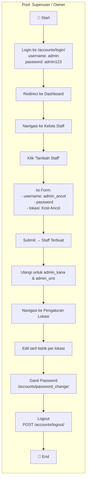

### 5.2 BPMN — Modul Manajemen Kamar

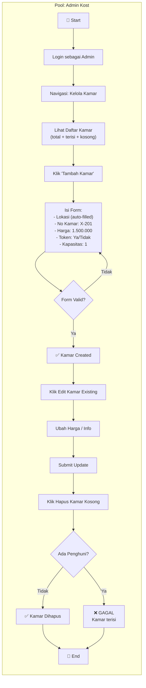

### 5.3 BPMN — Modul Tenant Lifecycle (Check-In → Check-Out)

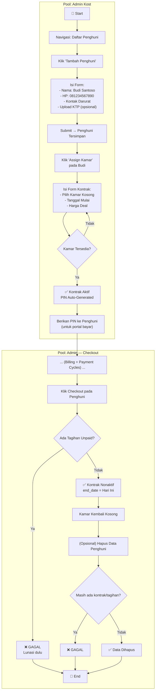

### 5.4 BPMN — Modul Billing & Payment (Proses Inti)

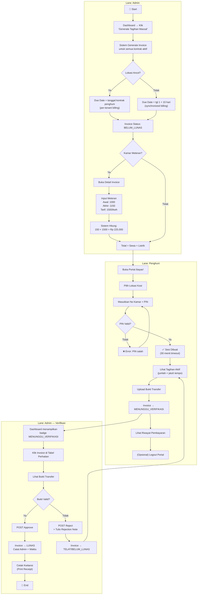

### 5.5 BPMN — Modul Maintenance Ticket

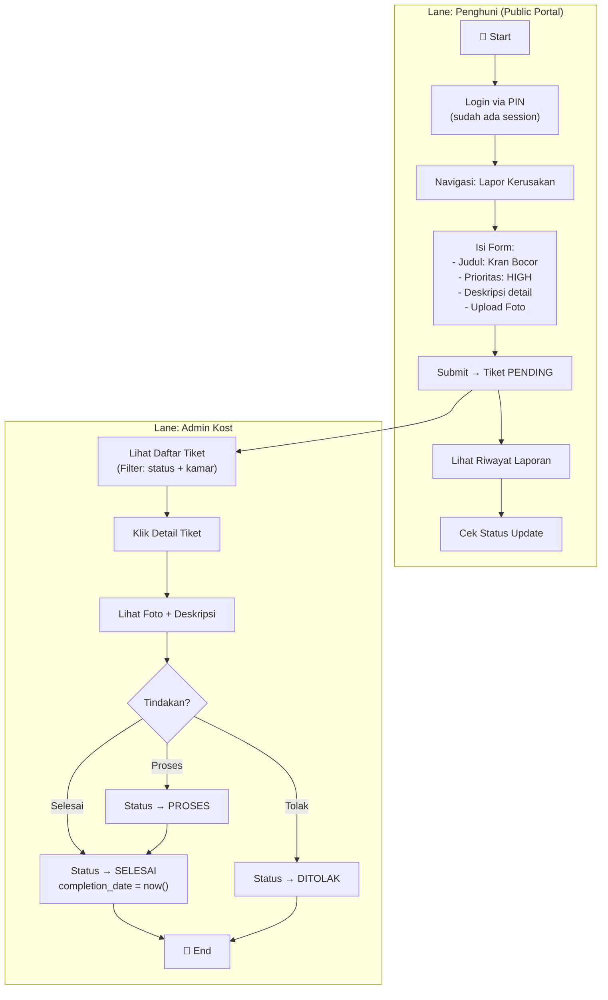

### 5.6 BPMN — Modul Biaya Operasional

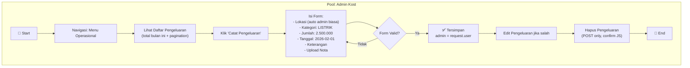

### 5.7 BPMN — Modul Laporan Keuangan

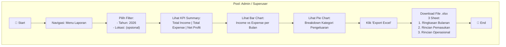

---

## 6. STATE DIAGRAM — INVOICE LIFECYCLE

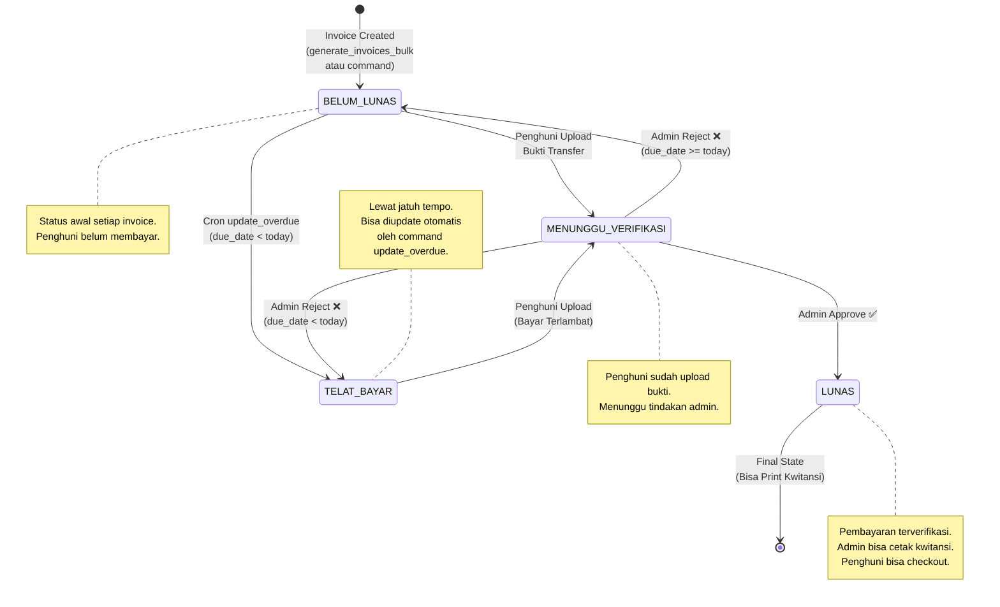

---

## 7. STATE DIAGRAM — MAINTENANCE TICKET

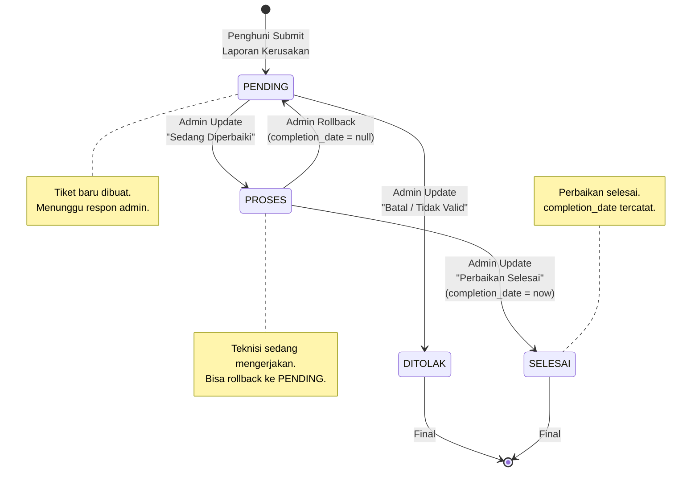

---

## 8. RENCANA SIMULASI PER FASE

### FASE 0: System Setup (Prerequisite)

| Step | Aksi | Aktor | Expected Result | Fitur ID |
| ---- | ---- | ----- | --------------- | -------- |
| 0.1 | Jalankan `python manage.py migrate` | System | Database schema terbuat | F-47 |
| 0.2 | Jalankan `python manage.py seed_data` | System | 3 lokasi, 68 kamar, ~54 tenant, invoices terbuat | F-42 |
| 0.3 | Hit `GET /health/` | System | `{"status":"ok","database":"connected"}` | F-45 |
| 0.4 | Login Superuser (`admin`/`admin123`) | Superuser | Redirect ke dashboard, sidebar lengkap muncul | F-08, F-12 |
| 0.5 | Buka `/admin/` | Superuser | Django admin panel terbuka | F-46 |

### FASE 1: Staff & Location Management

| Step | Aksi | Aktor | Expected Result | Fitur ID |
| ---- | ---- | ----- | --------------- | -------- |
| 1.1 | Navigasi ke Kelola Staff | Superuser | Lihat daftar 0 staff (jika fresh) | F-39 |
| 1.2 | Tambah Staff `admin_ancol` → Lokasi: Kost Ancol | Superuser | User terbuat + AdminProfile linked | F-40 |
| 1.3 | Tambah Staff `admin_kana` → Lokasi: Kost Kana | Superuser | User terbuat + AdminProfile linked | F-40 |
| 1.4 | Tambah Staff `admin_uns` → Lokasi: Kost UNS | Superuser | User terbuat + AdminProfile linked | F-40 |
| 1.5 | Edit Staff `admin_ancol` → ubah nama depan | Superuser | Data updated | F-41 |
| 1.6 | Navigasi ke Pengaturan Lokasi | Superuser | Lihat 3 lokasi | F-13 |
| 1.7 | Edit Kost Ancol → ubah tarif ke 1600 | Superuser | Tarif updated | F-14 |
| 1.8 | Dashboard → filter per lokasi | Superuser | Data berubah sesuai filter | F-12 |
| 1.9 | Logout Superuser | Superuser | Redirect ke login | F-09 |

### FASE 2: Room Management (sebagai Admin Biasa)

| Step | Aksi | Aktor | Expected Result | Fitur ID |
| ---- | ---- | ----- | --------------- | -------- |
| 2.1 | Login `admin_ancol` | Admin | Dashboard Kost Ancol only | F-08, F-12 |
| 2.2 | Navigasi ke Kelola Kamar | Admin | List 40 kamar Ancol saja | F-15 |
| 2.3 | Tambah Kamar A-141 (Rp 1.800.000, Token) | Admin | Kamar terbuat, lokasi auto Ancol | F-16 |
| 2.4 | Edit Kamar A-141 → ubah harga ke 1.900.000 | Admin | Harga updated | F-17 |
| 2.5 | Hapus Kamar A-141 (kamar kosong) | Admin | Kamar deleted | F-18 |
| 2.6 | Coba hapus kamar berpenghuni | Admin | ❌ Error: masih ada penghuni | F-18 |
| 2.7 | Navigasi ke Pengaturan | Admin | Redirect ke edit Kost Ancol | F-13 |
| 2.8 | Edit tarif listrik Ancol | Admin | Tarif updated | F-14 |

### FASE 3: Tenant Onboarding

| Step | Aksi | Aktor | Expected Result | Fitur ID |
| ---- | ---- | ----- | --------------- | -------- |
| 3.1 | Navigasi Daftar Penghuni | Admin | Lihat tenant Ancol only + KPI | F-19 |
| 3.2 | Search penghuni by nama | Admin | Filtered results, KPI tetap | F-19 |
| 3.3 | Tambah Penghuni Baru: "Test User" | Admin | Tenant created | F-20 |
| 3.4 | Edit Penghuni "Test User" → ubah phone | Admin | Data updated | F-21 |
| 3.5 | Assign Kamar ke "Test User" → pilih kamar kosong | Admin | Kontrak terbuat + PIN auto | F-22 |
| 3.6 | Coba Assign lagi (sudah punya kontrak) | Admin | ❌ Error: sudah ada kontrak aktif | F-22 |
| 3.7 | Catat PIN yang ter-generate | Admin | PIN = 6 digit angka | F-22 |

### FASE 4: Billing Cycle

| Step | Aksi | Aktor | Expected Result | Fitur ID |
| ---- | ---- | ----- | --------------- | -------- |
| 4.1 | Dashboard → Generate Tagihan Massal | Admin | X tagihan baru terbuat | F-28 |
| 4.2 | Buka Daftar Tagihan | Admin | Lihat semua tagihan lokasi | F-25 |
| 4.3 | Filter tagihan: BELUM_LUNAS | Admin | Hanya belum lunas muncul | F-25 |
| 4.4 | Search tagihan by nama penghuni | Admin | Filtered result | F-25 |
| 4.5 | Buka Detail Tagihan (kamar meteran) | Admin | Form listrik muncul | F-26 |
| 4.6 | Input: Awal=1000, Akhir=1150, Tarif=1500 | Admin | Listrik=225.000, Total updated | F-26 |
| 4.7 | Coba input: Akhir < Awal (validasi) | Admin | ❌ Error: akhir < awal | F-26 |
| 4.8 | Jalankan `python manage.py update_overdue` | System | Tagihan lewat due_date → TELAT_BAYAR | F-44 |
| 4.9 | Jalankan `python manage.py generate_monthly_invoices` | System | Tagihan bulan depan terbuat | F-43 |

### FASE 5: Public Payment Portal

| Step | Aksi | Aktor | Expected Result | Fitur ID |
| ---- | ---- | ----- | --------------- | -------- |
| 5.1 | Buka `/` (Landing Page) | Visitor | Halaman home tampil | F-01 |
| 5.2 | Buka `/bayar/` | Penghuni | Form validasi PIN | F-02 |
| 5.3 | Submit dengan PIN salah | Penghuni | ❌ Error: PIN salah | F-02 |
| 5.4 | Submit dengan lokasi + kamar + PIN benar | Penghuni | ✅ Redirect ke upload page | F-02 |
| 5.5 | Lihat info tagihan aktif | Penghuni | Jumlah + jatuh tempo tampil | F-03 |
| 5.6 | Upload bukti transfer (gambar valid) | Penghuni | ✅ Sukses, invoice → MENUNGGU | F-03 |
| 5.7 | Buka riwayat pembayaran | Penghuni | List semua invoice + pagination | F-04 |
| 5.8 | Logout portal publik | Penghuni | Session cleared, redirect ke PIN | F-05 |
| 5.9 | Buka `/bayar/upload/` tanpa session | Penghuni | Redirect ke PIN page | F-03 |

### FASE 6: Payment Verification

| Step | Aksi | Aktor | Expected Result | Fitur ID |
| ---- | ---- | ----- | --------------- | -------- |
| 6.1 | Login Admin → Dashboard | Admin | Badge pending muncul | F-12 |
| 6.2 | Lihat Tabel Perhatian: MENUNGGU | Admin | Invoice + nama penghuni tampil | F-12 |
| 6.3 | Approve pembayaran valid | Admin | Invoice → LUNAS | F-29 |
| 6.4 | Cetak kwitansi invoice LUNAS | Admin | Halaman print tampil | F-27 |
| 6.5 | Coba print invoice non-LUNAS | Admin | ❌ Error: hanya LUNAS | F-27 |
| 6.6 | Reject pembayaran tidak valid | Admin | Invoice → TELAT/BELUM sesuai due_date | F-30 |
| 6.7 | Coba verifikasi lintas lokasi | Admin | ❌ Error: bukan lokasimu | F-29 |

### FASE 7: Maintenance Ticket Flow

| Step | Aksi | Aktor | Expected Result | Fitur ID |
| ---- | ---- | ----- | --------------- | -------- |
| 7.1 | Login penghuni via PIN | Penghuni | Session created | F-02 |
| 7.2 | Navigasi ke /lapor/ | Penghuni | Form laporan kerusakan | F-06 |
| 7.3 | Submit laporan: "Kran Bocor", HIGH | Penghuni | Tiket PENDING terbuat | F-06 |
| 7.4 | Lihat riwayat laporan | Penghuni | Tiket muncul di list | F-07 |
| 7.5 | Admin: lihat daftar tiket | Admin | Filter status + kamar | F-35 |
| 7.6 | Admin: filter by status PENDING | Admin | Hanya pending muncul | F-35 |
| 7.7 | Admin: update tiket → PROSES | Admin | Status berubah | F-36 |
| 7.8 | Admin: update tiket → SELESAI | Admin | completion_date tercatat | F-36 |
| 7.9 | Admin: coba status invalid | Admin | ❌ Error: status tidak valid | F-36 |

### FASE 8: Operational Costs

| Step | Aksi | Aktor | Expected Result | Fitur ID |
| ---- | ---- | ----- | --------------- | -------- |
| 8.1 | Navigasi ke Operasional | Admin | List pengeluaran + total bulan ini | F-31 |
| 8.2 | Catat pengeluaran: LISTRIK Rp 2.500.000 | Admin | ✅ Tersimpan, lokasi auto | F-32 |
| 8.3 | Catat pengeluaran: PAM Rp 800.000 | Admin | ✅ Tersimpan | F-32 |
| 8.4 | Edit pengeluaran → ubah jumlah | Admin | Data updated | F-33 |
| 8.5 | Hapus pengeluaran | Admin | Confirm → deleted | F-34 |
| 8.6 | Coba akses pengeluaran lokasi lain | Admin | ❌ Tidak muncul di list | F-31 |

### FASE 9: Financial Reporting

| Step | Aksi | Aktor | Expected Result | Fitur ID |
| ---- | ---- | ----- | --------------- | -------- |
| 9.1 | Navigasi ke Laporan | Admin | Dashboard chart tampil | F-37 |
| 9.2 | Filter tahun: 2026 | Admin | Data berubah sesuai filter | F-37 |
| 9.3 | Lihat bar chart income vs expense | Admin | 12 bulan ditampilkan | F-37 |
| 9.4 | Lihat pie chart kategori | Admin | Breakdown pengeluaran | F-37 |
| 9.5 | Login Superuser → filter lokasi | Superuser | Dropdown lokasi muncul | F-37 |
| 9.6 | Klik Export Excel | Admin | File .xlsx terdownload | F-38 |
| 9.7 | Buka file Excel → cek 3 sheet | Admin | Ringkasan + Income + Expense sheet ada | F-38 |

### FASE 10: Tenant Checkout & Cleanup

| Step | Aksi | Aktor | Expected Result | Fitur ID |
| ---- | ---- | ----- | --------------- | -------- |
| 10.1 | Coba checkout tenant dengan tagihan unpaid | Admin | ❌ Ditolak | F-23 |
| 10.2 | Lunasi semua tagihan tenant | Admin | Semua LUNAS | F-29 |
| 10.3 | Checkout tenant | Admin | ✅ Kontrak nonaktif, end_date diisi | F-23 |
| 10.4 | Cek kamar → statusnya KOSONG | Admin | Kamar available | F-15 |
| 10.5 | Delete data tenant (sudah checkout) | Admin | ✅ Tenant dihapus | F-24 |
| 10.6 | Coba delete tenant yang masih aktif | Admin | ❌ Ditolak | F-24 |

### FASE 11: Security & Edge Cases

| Step | Aksi | Aktor | Expected Result | Fitur ID |
| ---- | ---- | ----- | --------------- | -------- |
| 11.1 | Admin Ancol coba akses data Kana | Admin | ❌ Data tersembunyi/redirect | All |
| 11.2 | Non-superuser coba akses /management/staff/ | Admin | ❌ Redirect ke dashboard | F-39 |
| 11.3 | Akses halaman admin tanpa login | Anon | Redirect ke login | All |
| 11.4 | Upload file > 5MB | Penghuni | ❌ Validasi error | F-03 |
| 11.5 | Upload file non-image (.exe) | Penghuni | ❌ Format tidak didukung | F-03 |
| 11.6 | Generate tagihan 2x (idempotent) | Admin | Skip yang sudah ada | F-28 |
| 11.7 | Ganti password admin | Admin | Password changed | F-10 |

---

## 9. MATRIKS TEST CASE LENGKAP

### Ringkasan Coverage

| Modul | Jumlah Test | Fitur Covered |
| ----- | ----------- | ------------- |
| Setup & Infra | 5 | F-42, F-45, F-46, F-47 |
| Auth & Staff | 9 | F-08, F-09, F-10, F-11, F-39, F-40, F-41 |
| Room Management | 8 | F-13, F-14, F-15, F-16, F-17, F-18 |
| Tenant Lifecycle | 7 | F-19, F-20, F-21, F-22, F-23, F-24 |
| Billing | 9 | F-25, F-26, F-28, F-43, F-44 |
| Public Portal | 9 | F-01, F-02, F-03, F-04, F-05 |
| Payment Verification | 7 | F-12, F-27, F-29, F-30 |
| Maintenance | 9 | F-06, F-07, F-35, F-36 |
| Operational Cost | 6 | F-31, F-32, F-33, F-34 |
| Reporting | 7 | F-37, F-38 |
| Checkout & Cleanup | 6 | F-23, F-24, F-15 |
| Security & Edge | 7 | Cross-cutting |
| **TOTAL** | **89 test steps** | **47/47 fitur (100%)** |

---

## 10. SEQUENCE DIAGRAM — ALUR KRITIS

### 10.1 Sequence: Full Payment Flow (Happy Path)

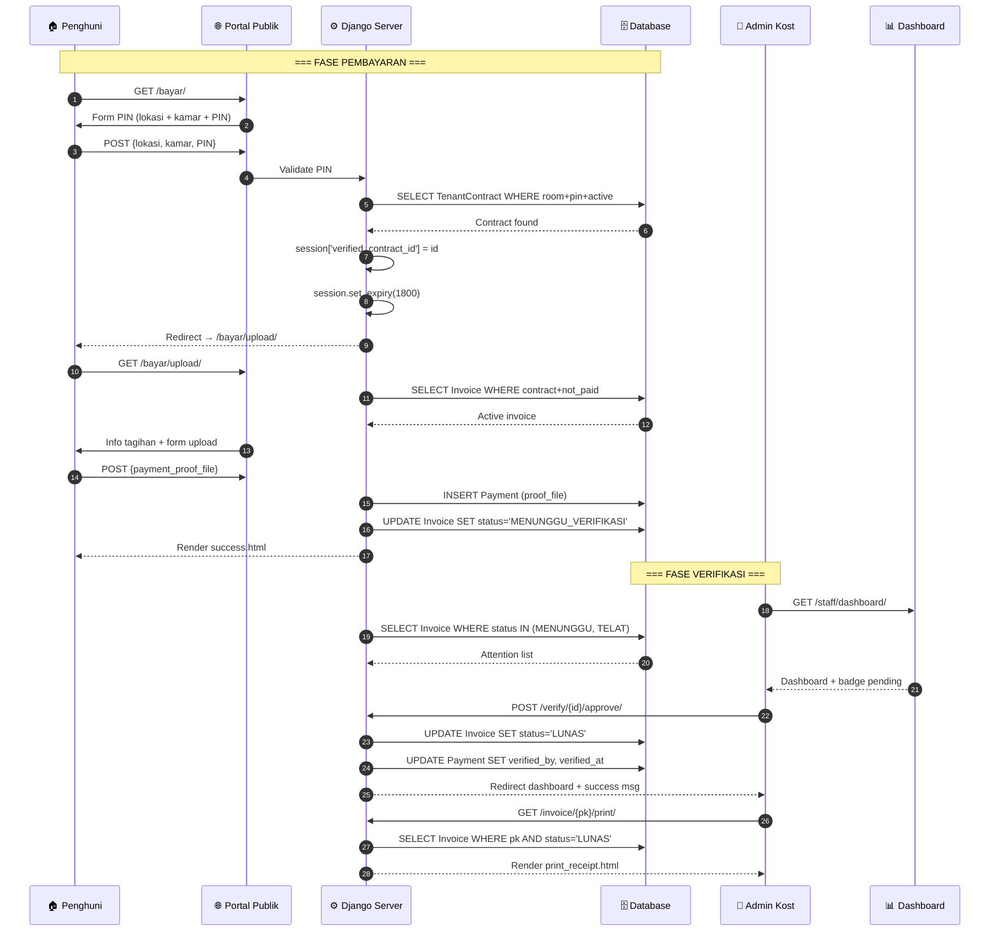

### 10.2 Sequence: Maintenance Ticket Flow

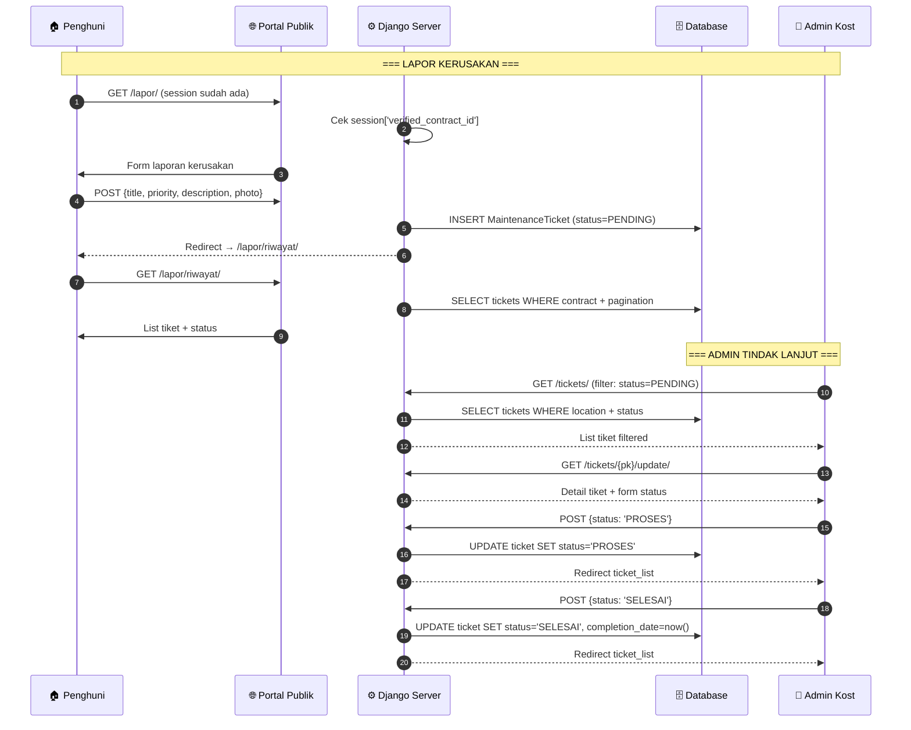

### 10.3 Sequence: Tenant Lifecycle (Onboarding → Checkout)

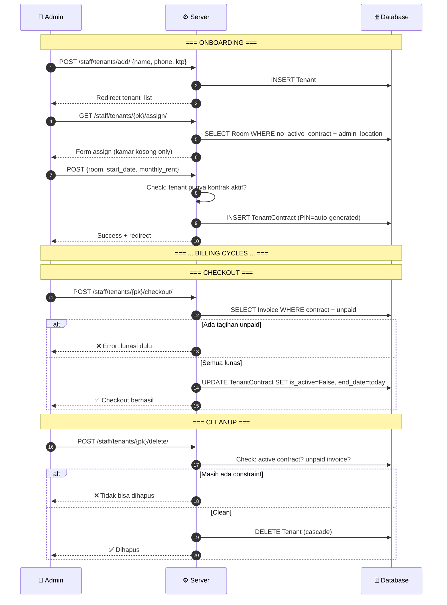

---

## LAMPIRAN A: Checklist Validasi Simulasi

Gunakan checklist ini untuk memastikan setiap fitur telah divalidasi:

- [ ] **F-01** Landing Page: `/` tampil benar
- [ ] **F-02** PIN Validation: sukses + gagal
- [ ] **F-03** Upload Bukti: file valid + file invalid + tanpa tagihan
- [ ] **F-04** Riwayat Pembayaran: list + pagination
- [ ] **F-05** Public Logout: session terhapus
- [ ] **F-06** Buat Laporan Kerusakan: form + submit
- [ ] **F-07** Riwayat Laporan: list + pagination
- [ ] **F-08** Login Admin: sukses + gagal
- [ ] **F-09** Logout Admin: redirect ke login
- [ ] **F-10** Ganti Password: change + done
- [ ] **F-11** Password Change Done: halaman success
- [ ] **F-12** Dashboard: KPI + room visual + attention table + filter
- [ ] **F-13** Location List: superuser list + admin redirect
- [ ] **F-14** Location Update: edit tarif
- [ ] **F-15** Room List: daftar + occupancy
- [ ] **F-16** Room Create: tambah kamar + lokasi auto
- [ ] **F-17** Room Update: edit berhasil
- [ ] **F-18** Room Delete: kosong → hapus, terisi → tolak
- [ ] **F-19** Tenant List: search + pagination + KPI
- [ ] **F-20** Tenant Create: tambah penghuni
- [ ] **F-21** Tenant Update: edit penghuni
- [ ] **F-22** Assign Room: kontrak + PIN auto
- [ ] **F-23** Tenant Checkout: sukses + ditolak (ada unpaid)
- [ ] **F-24** Tenant Delete: sukses + ditolak (ada constraint)
- [ ] **F-25** Invoice List: filter status + search + pagination
- [ ] **F-26** Invoice Detail: input listrik + validasi
- [ ] **F-27** Print Receipt: LUNAS berhasil + non-LUNAS ditolak
- [ ] **F-28** Generate Bulk Invoices: create + idempotent skip
- [ ] **F-29** Approve Payment: invoice → LUNAS
- [ ] **F-30** Reject Payment: invoice → TELAT/BELUM + rejection_note
- [ ] **F-31** Operation List: daftar + total bulan ini
- [ ] **F-32** Operation Create: catat + upload nota
- [ ] **F-33** Operation Update: edit berhasil
- [ ] **F-34** Operation Delete: hapus + confirm
- [ ] **F-35** Admin Ticket List: filter status + kamar + pagination
- [ ] **F-36** Admin Ticket Update: PENDING → PROSES → SELESAI + invalid status
- [ ] **F-37** Finance Report: chart + filter tahun/lokasi
- [ ] **F-38** Export Excel: download + 3 sheet
- [ ] **F-39** Staff List: daftar admin
- [ ] **F-40** Staff Create: tambah admin + assign lokasi
- [ ] **F-41** Staff Update: edit data admin
- [ ] **F-42** Seed Data: command berhasil
- [ ] **F-43** Generate Monthly Invoices: command berhasil
- [ ] **F-44** Update Overdue: command berhasil
- [ ] **F-45** Health Check: response JSON 200
- [ ] **F-46** Django Admin: panel terbuka
- [ ] **F-47** Dockerfile: build + run

---

## LAMPIRAN B: Business Rules Kritis

### B1: Aturan Billing Ancol vs Non-Ancol

```
IF lokasi mengandung "ancol" (case-insensitive):
    billing_start = bulan_depan.replace(day=contract.start_date.day)
    due_date = billing_start  (jatuh tempo langsung)
ELSE:
    billing_start = bulan_depan.replace(day=1)
    due_date = billing_start + 10 hari
```

### B2: Aturan Checkout

```
JIKA ada Invoice dengan status IN ('BELUM_LUNAS', 'TELAT_BAYAR', 'MENUNGGU_VERIFIKASI'):
    → TOLAK checkout
JIKA semua Invoice = 'LUNAS' atau tidak ada Invoice:
    → Kontrak.is_active = False
    → Kontrak.end_date = today()
```

### B3: Aturan Auto-PIN

```
SAAT kontrak disimpan DAN payment_pin kosong:
    → Loop generate random 6 digit
    → Cek uniqueness di database
    → Simpan PIN unik
```

### B4: Aturan Perhitungan Listrik

```
usage = meter_end - meter_start
IF usage < 0: usage = 0
calculated = usage × rate_per_kwh
invoice.electricity_bill_amount = calculated
invoice.total_amount = base_rent + electricity_bill_amount  (auto-recalc di save)
```

### B5: Aturan Keamanan Lokasi

```
Admin biasa HANYA bisa:
    - Melihat data di lokasinya sendiri
    - Mengelola (CRUD) data di lokasinya sendiri
    - TIDAK bisa mengakses data lokasi lain

Superuser:
    - Akses semua lokasi
    - Bisa filter per lokasi di dashboard & laporan
```

---

> **Dokumen ini siap digunakan sebagai acuan untuk pembuatan script automation testing (Step 2).**  
> **Cakupan: 47 fitur, 89 test steps, 100% feature coverage.**
