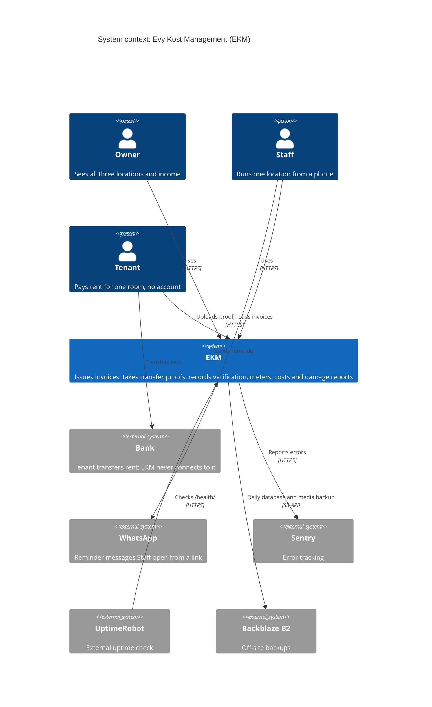
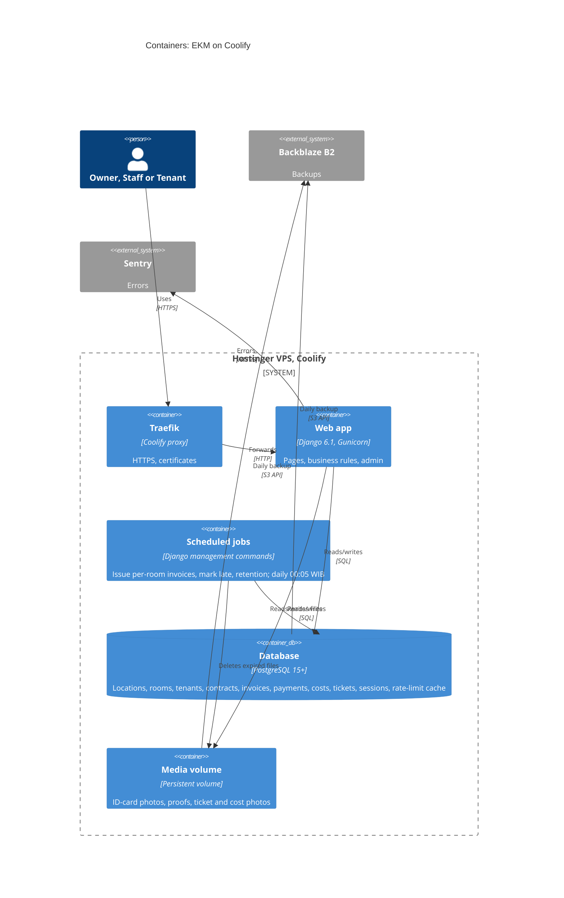
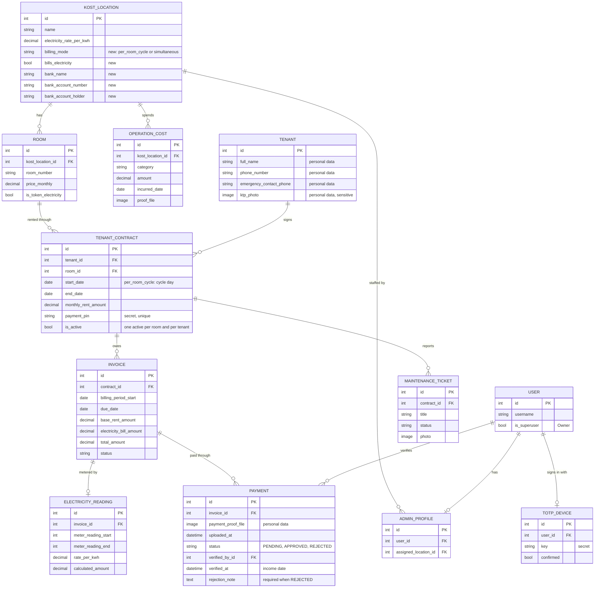
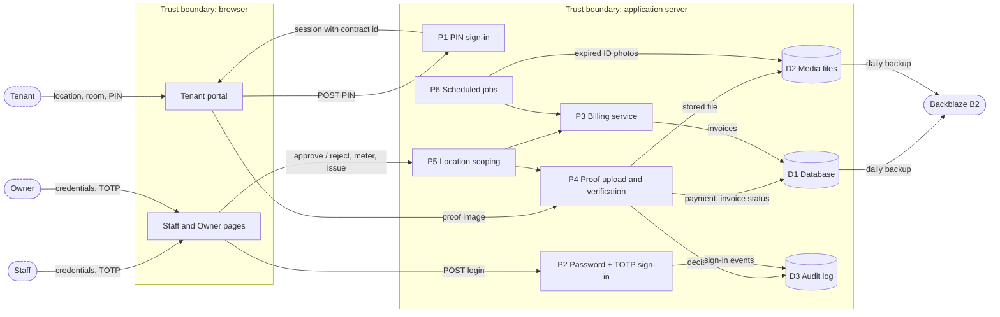
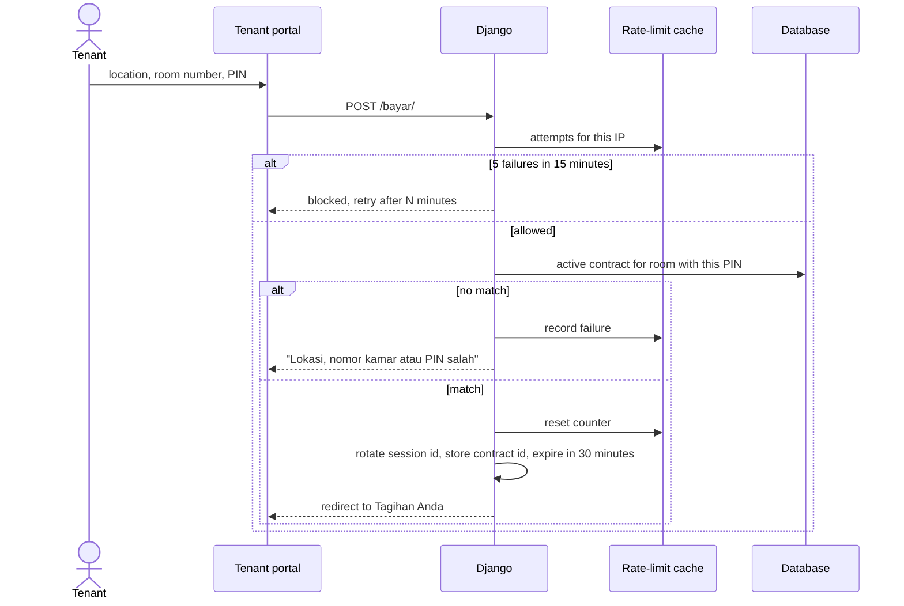
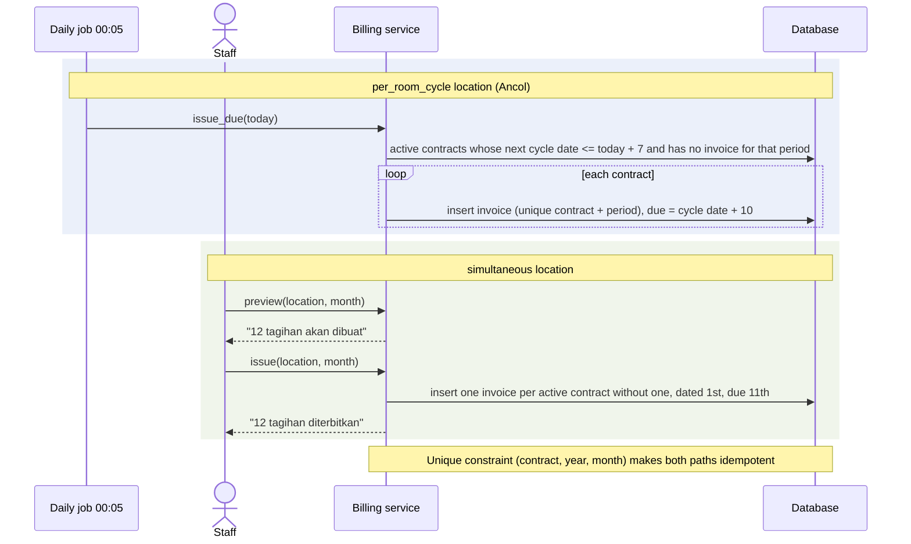
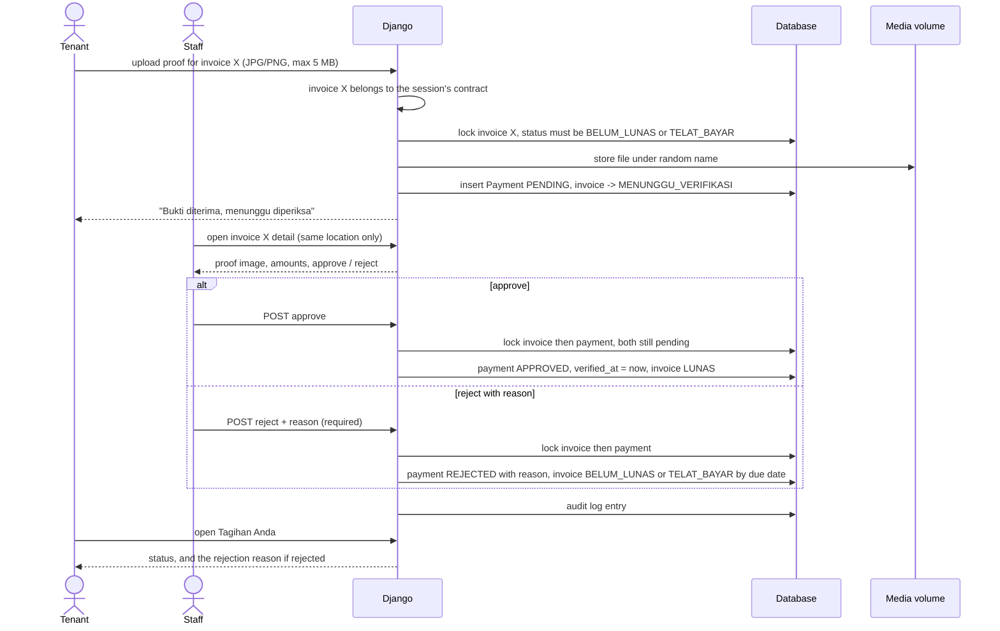
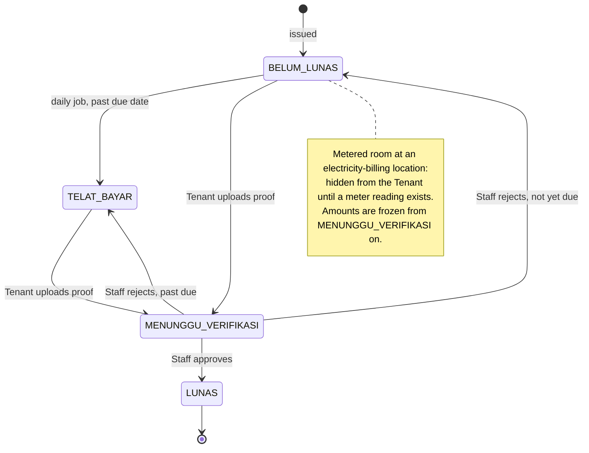
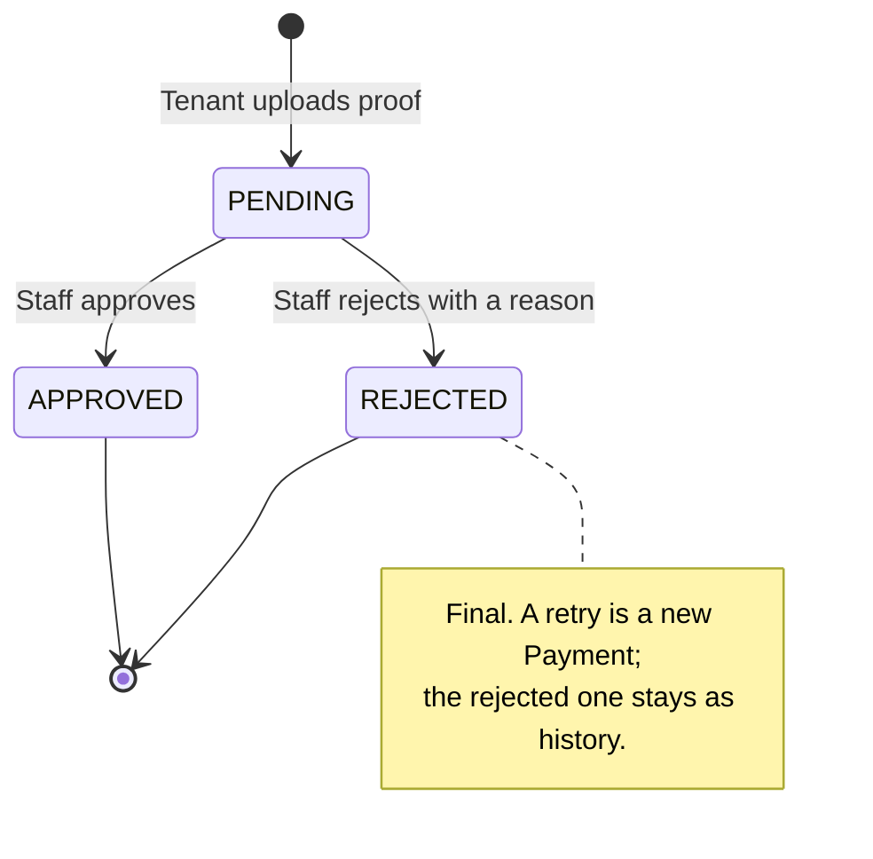
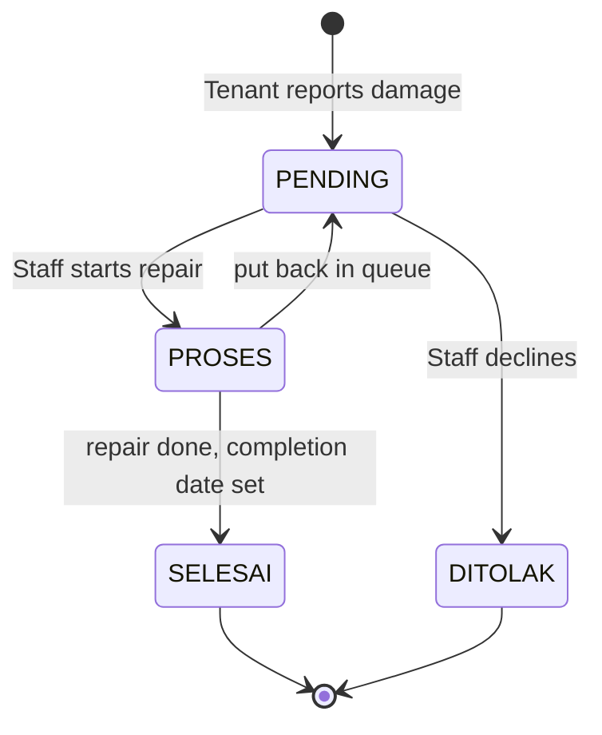

# Design Report: Evy Kost Management (EKM)

Source of truth: `docs/ledger.yaml` (47 entries). Date: 2026-11-14. Plane: EKM-2.

## 0. Executive summary

EKM runs rent collection for three kost locations of about 80 rooms each, for one Owner, two or three Staff and the Tenants. The revision keeps the existing Django application and its financial rules, and reworks the flows, the page structure and the visual design (Plat Nomor direction, Tailwind CSS). The largest flow changes:

- Billing mode becomes a per-location setting: Ancol bills every room on its own cycle date, automatically, with electricity; the other two locations issue all invoices at once from one Staff action.
- Staff work from a home-page queue.
- Tenants see every unpaid invoice with the bank account to pay into.

Main risks:

- Production holds real data and its PostgreSQL version is unknown (Django 6.1 needs 15 or newer).
- ASVS Level 2 makes TOTP mandatory for Staff as well as the Owner.
- Two access-control gaps found in the media view must be closed.

Gate 1 asks the owner to approve this report, the diagrams, the approved mockups, the four open questions in section 11, and the installation of the test tooling in section 9.

## 1. Product

**Problem.** The current site works but its flows confuse Staff and Tenants, and the owner judges it unfit for production (R-002, R-003).

**Personas** (R-001):

| Persona | Goal | Pain today |
|---|---|---|
| Owner | See occupancy and money actually received at all locations | Two income figures computed two ways (R-026) |
| Staff | Clear the day's work on a phone: verify proofs, record meters, chase late invoices, answer damage reports | Work is spread over pages; verification sits on the dashboard, apart from the invoice and its proof |
| Tenant | Know what is owed, where to transfer, and whether it was accepted | No bank account shown; only the newest unpaid invoice visible (R-021, R-022) |

**Goals and success metrics** (R-003, R-005):

- A first-time Staff member verifies a proof and records a meter reading on a phone in under 2 minutes per invoice.
- A Tenant uploads a proof in under 3 minutes on the first attempt.
- Main pages respond in under 1 second at 240 rooms.

**Scope** (D-001, R-004):

- **In:** rework of every existing feature in place.
- **Additions:** bank details per location and TOTP sign-in.
- **Out:** native app, payment gateway, Tenant accounts, multi-owner.

## 2. Requirements

**Functional requirements:** 32 `R-` entries, each with acceptance criteria in the ledger and traced in Appendix A. Critical stories:

- R-012 and R-013: per-room cycle and automatic issue.
- R-014: simultaneous issue.
- R-015: meter gating.
- R-017: verification on the invoice detail.
- R-018: Tenant home.
- R-021: bank details.
- R-025: checkout.

**Non-functional requirements:**

| Area | Requirement | Ledger |
|---|---|---|
| Performance | p95 under 1000 ms for Staff home, invoice list and room list at 3 x 80 rooms with 12 months of invoices | R-005 |
| Availability | 99% per month; data loss at most 24 h | R-030 |
| Security | OWASP ASVS 5.0 Level 2; TOTP for Owner and Staff | R-007, R-031 |
| Privacy | UU 27/2022: contract as legal basis, privacy notice, ID photo deleted 30 days after checkout, records kept 5 years | R-006, R-032 |
| Accessibility | WCAG 2.2 AA, axe zero critical or serious | R-009 |
| Language and format | Indonesian only; `Rp 1.850.000`; `14 November 2026` | R-009 |
| Platform | Web, mobile-first at 375px, no horizontal page scroll | R-009 |
| Currency of stack | Latest stable Python, Django and dependencies at release | R-008, D-006 |

## 3. Architecture

<!-- source: docs/diagrams/c4-context.mmd -->

<!-- source: docs/diagrams/c4-container.mmd -->

**Stack:** Django 6.1 on the newest Python series it supports with Pillow and psycopg wheels available, PostgreSQL 15 or newer, Tailwind CSS built by its standalone CLI, no JavaScript framework. See ADR 0001; the frontend not being TypeScript is a recorded deviation.

**Modules and seams.** Business rules leave the views (D-005). Each module below has a small interface and hides the rules behind it. Views become thin: parse the request, call one module, render.

| Module | Interface | Hides |
|---|---|---|
| `core/scoping.py` | `location_for(user)` and `scoped(queryset, user, path)` | Owner sees all; Staff sees one location; Staff without a location sees nothing. Replaces the check repeated in about 25 views. |
| `finance/billing.py` | `issue_due(today)`, `preview(location, month)`, `issue(location, month)`, `first_invoice(contract)` | Billing mode, cycle-date clamping, proration, due dates, idempotency through the unique period constraint (D-013, ADR 0002) |
| `finance/payments.py` | `submit_proof(contract, invoice, file)`, `approve(payment, user)`, `reject(payment, user, reason)` | Lock order Invoice then Payment, state checks inside the lock, audit log |
| `finance/income.py` | `income(location, start, end)` | One income basis (verification date) for the dashboard, report and export (R-026) |
| `tenants/onboarding.py` | `onboard(tenant_data, room, move_in)` | Tenant, contract with PIN and first invoice in one transaction (R-016) |
| `tenants/retention.py` | `apply_retention(today)` | 30-day ID-photo deletion, 5-year record deletion (R-006) |

**Scheduled work:** three idempotent management commands, run daily at 00:05 WIB by Coolify (ADR 0003).

## 4. Data

<!-- source: docs/diagrams/erd.mmd -->

**Data changes** (all expand-contract, section 10):

| Change | Reason |
|---|---|
| `KostLocation.billing_mode`, `bills_electricity` | Replace name-based Ancol detection (R-027). The data migration sets Ancol to `per_room_cycle` with electricity and the other two to `simultaneous` without. |
| `KostLocation.bank_name`, `bank_account_number`, `bank_account_holder` | R-021 |
| `Payment.rejection_note` required when `REJECTED` (check constraint) | R-017 |
| `TOTPDevice` from django-otp | R-031, D-015 |
| Tenant-visible invoices are a query, not a field: hidden while the room is metered at an electricity-billing location and no reading exists | R-015 |

**Personal data** (UU 27/2022; legal basis: the rental contract, R-032):

| Field | Class | Who reads it | Retention |
|---|---|---|---|
| `Tenant.full_name`, `phone_number`, `emergency_contact_phone` | Personal | Staff of the tenant's location, Owner | 5 years after checkout, then deleted (R-006) |
| `Tenant.ktp_photo` | Personal, sensitive (national ID) | Staff of the tenant's location, Owner | Deleted 30 days after checkout (R-006) |
| `Payment.payment_proof_file` | Personal (bank account, name) | The tenant, Staff of the location, Owner | With the invoice, 5 years |
| `TenantContract.payment_pin` | Secret | The tenant, Staff of the location (relay workflow) | Until checkout |
| `MaintenanceTicket.photo` | May show personal items | The tenant, Staff of the location, Owner | With the contract record |
| `User` credentials, TOTP key | Secret | Nobody in clear | While the account exists |

**Data-subject rights:**

- A Tenant asks Staff for correction or deletion; Staff correct it in the tenant form.
- Deleting a checked-out tenant before 5 years is an Owner action, logged.

**Breach handling:** a written procedure with the 3 x 24 hour notification deadline lives in `docs/operations/BREACH.md`, written in Build (R-032).

## 5. Flows

**Data flow (DFD level 1, input to STRIDE):**

<!-- source: docs/diagrams/dfd.mmd -->

**Tenant PIN sign-in.** The session id is rotated on success; it is not today.

<!-- source: docs/diagrams/seq-pin-signin.mmd -->

**Invoice issuing, both billing modes:**

<!-- source: docs/diagrams/seq-invoice-issue.mmd -->

Billing rules:

- **Cycle date:** the contract start day, clamped to the last day of shorter months (R-012).
- **Ancol (`per_room_cycle`):**
  - The invoice is issued 7 days before the cycle date and is due 10 days after it (R-013).
  - The first invoice is a full month from move-in (R-023).
- **The other two locations (`simultaneous`):**
  - Invoices are dated the 1st and due the 11th (R-014).
  - The first invoice is prorated by day to the end of the month (R-023).
- **Late:** an unpaid invoice past its due date is marked late by the daily job; no fee is added (R-024).

**Proof upload and verification:**

<!-- source: docs/diagrams/seq-proof-verify.mmd -->

**Invoice lifecycle:**

<!-- source: docs/diagrams/state-invoice.mmd -->

**Payment lifecycle:**

<!-- source: docs/diagrams/state-payment.mmd -->

**Damage report lifecycle:**

<!-- source: docs/diagrams/state-ticket.mmd -->

**Checkout** (R-025):

- Checkout is refused while any invoice of the contract is unpaid or awaiting verification.
- There is no refund or prorated last month, and deposits are not recorded.
- After checkout the room shows as empty and the retention clock starts.

## 6. Security

OWASP ASVS 5.0 Level 2: the application has authentication, personal data and payment evidence (R-007). STRIDE over the DFD in section 5:

| Threat | STRIDE | Element | Threat | Mitigation | ASVS 5.0 chapter | Test or accepted risk |
|---|---|---|---|---|---|---|
| T-001 | Spoofing | P1 PIN sign-in | Guessing a 6-digit PIN for a known room | Rate limit 5 failures per 15 min per IP (exists); identical error for wrong room or PIN; PIN tied to location and room | V6 Authentication | `tests_simulation` phase 7; residual risk is open question O-1 |
| T-002 | Spoofing | P2 Staff/Owner sign-in | Credential stuffing or a stolen password | django-axes lockout (exists); TOTP for Owner and Staff (R-031) | V6 Authentication | `e2e/test_signin.py::test_R031_totp_required` |
| T-003 | Spoofing | Portal session | Session fixation after PIN entry | Rotate the session id on PIN success (new); HttpOnly, Secure, SameSite (exists); 30-minute expiry | V7 Session Management | unit test on the PIN view: session key changes |
| T-004 | Tampering | P4 proof upload | Malicious or oversized file | JPG/PNG only, 5 MB, Pillow verification, random file names, served only through the protected view (exists) | V5 File Handling | `tests_simulation` phase 7 (10 to 12) |
| T-005 | Tampering | D1 invoices | Amounts changed after payment | Model guard and read-only admin for awaiting and paid invoices (exists) | V2 Validation and Business Logic | `tests_simulation` W2, W5 |
| T-006 | Tampering | P4 verification | Approve and reject racing; double approval | Lock Invoice then Payment; state checks inside the lock (exists) | V2 Validation and Business Logic | `tests_postgres_concurrency.py` |
| T-007 | Repudiation | P4 verification | Staff denies a decision | `verified_by`, `verified_at` and the reason stored on Payment; audit log to stdout, kept by Coolify (today a file in the container, lost on redeploy) | V16 Security Logging | unit test: reject writes an audit entry |
| T-008 | Information disclosure | Media view | A Tenant with any valid PIN session opens another tenant's proof or ticket photo; the view checks the folder, not the owner | Look up the record behind the file and require it to belong to the session's contract (new) | V8 Authorization | `e2e/test_isolation.py::test_R007_tenant_cannot_open_other_proof` |
| T-009 | Information disclosure | Media view, Staff pages | Staff of one location open ID photos or proofs of another; the media view checks only `is_staff` | One scoping module for pages and media (D-005, new) | V8 Authorization | `e2e/test_isolation.py::test_R007_staff_cannot_open_other_location_ktp` |
| T-010 | Information disclosure | Backups in B2 | ID photos leak from the backup bucket | Private bucket, key scoped to that bucket, server-side encryption; retention deletes photos at source | V14 Data Protection | Ship checklist |
| T-011 | Information disclosure | Errors | Stack traces or personal data in error output or Sentry | `DEBUG` off (deploy check); health check hides DB errors (exists); Sentry `send_default_pii=False` | V16 Security Logging | `manage.py check --deploy` in CI |
| T-012 | Denial of service | P4 upload, P1 | Flooding uploads or PIN attempts | 5 MB limit at Django and proxy; PIN rate limit; upload needs a PIN session | V2 Validation and Business Logic | `tests_simulation` phase 7 |
| T-013 | Elevation of privilege | Location settings | Staff change billing mode or bank details to redirect payments | Owner-only views and admin for these fields; audit log on change | V8 Authorization | `e2e/test_isolation.py::test_R027_staff_cannot_change_billing` |
| T-014 | Elevation of privilege | Portal | A checked-out Tenant keeps using a session; history and report pages do not check the contract is active | Every portal view loads the contract with `is_active=True` (new) | V8 Authorization | unit test per portal view |
| T-015 | Tampering | Browser | CSRF or injected script | Django CSRF; django-csp policy (exists); no inline event handlers in the new templates | V3 Web Frontend Security | `manage.py check --deploy`; semgrep `p/django` |

Standing rules:

- Secrets only in Coolify environment variables and GitHub Actions secrets; `.env.example` only in the repo; gitleaks in CI.
- Lockfile (`uv.lock`) committed; one dependency upgrade per change; osv-scanner in CI.

## 7. UI/UX

Design system: [`DESIGN.md`](../../DESIGN.md), the Plat Nomor direction (D-004 v2).

- **Approved mockups (D-012):**
  - [Staff home](mockups/staff-home.html): [phone](mockups/staff-home-mobile.jpg), [desktop](mockups/staff-home-desktop.jpg).
  - [Tenant invoices](mockups/tenant-invoices.html): [phone](mockups/tenant-invoices-mobile.jpg).
- **Navigation (R-028):**
  - Staff have five items: Beranda, Tagihan, Penghuni & Kamar, Pengeluaran, Kerusakan.
  - The Owner adds Laporan Keuangan, Lokasi and Staff.
  - On a phone the navigation is a bottom bar; on desktop it is an enamel rail.
- **Typography and assets:**
  - System fonts only (D-007).
  - Tailwind built locally, so the CSP needs no external style host (D-008, D-009).

## 8. Code standards

- **Rules:** [`CONSTRAINTS.md`](../../CONSTRAINTS.md) holds the floor, the commands that enforce it (ruff, pyright, pytest, e2e with axe, osv-scanner, gitleaks, semgrep, Django deploy and migration checks, ledger check) and the project budgets.
- **Vocabulary:** [`GLOSSARY.md`](../../GLOSSARY.md) fixes one word per concept. Notably Owner and Staff, not "superadmin" or "admin kost"; and "issue", not "generate".
- **Conventions (D-005):**
  - Code and comments are in English; UI text is in Indonesian.
  - Business rules live in the modules of section 3.
  - Staff location scoping goes through one function.

## 9. Test strategy

**TDD seams** (Build writes the failing test first at these interfaces):

| Seam | Covers |
|---|---|
| `finance/billing.py` | R-012, R-013, R-014, R-015, R-023, R-024 |
| `finance/payments.py` | R-017, R-022, R-025 |
| `finance/income.py` | R-026 |
| `core/scoping.py` | R-007, R-027 |
| `tenants/onboarding.py` | R-016 |
| `tenants/retention.py` | R-006 |

**End-to-end** (D-014, ADR 0004): pytest-playwright with axe, one file per critical flow, test names carry the ledger id.

| File | Ledger ids |
|---|---|
| `e2e/test_billing.py` | R-012, R-013, R-014, R-015, R-023, R-024 |
| `e2e/test_verification.py` | R-017, R-018, R-021, R-022 |
| `e2e/test_onboarding.py` | R-016, R-025 |
| `e2e/test_isolation.py` | R-007, R-027 |
| `e2e/test_signin.py` | R-031 |
| `e2e/test_staff_home.py` | R-028, R-003 (timed walkthrough) |

**Test infrastructure to install after Gate 1:** uv (project and lockfile), pytest with pytest-django, pytest-playwright, axe-playwright-python, ruff, pyright, mutmut. In CI: osv-scanner, gitleaks, semgrep.

**Existing suite:**

- 185 Django tests keep running under pytest.
- They take 25 minutes today. The cause is not yet measured. Likely candidates are password hashing and image generation in `setUp`. Target: under 5 minutes.
- `tests_postgres_concurrency.py` runs in CI against PostgreSQL.

## 10. Deployment and operations

- **Environments:** Coolify on the owner's Hostinger VPS; `production` at https://ekm.web.id and `staging` at staging.ekm.web.id. They have separate databases and secrets; staging has resource limits (R-010, R-020).
- **Pipeline:**
  1. GitHub Actions runs every CI gate in CONSTRAINTS.md.
  2. It builds the image, pushed to GHCR tagged with the commit SHA.
  3. Coolify deploys that exact image.
  4. Migrations run once at start (existing `entrypoint.sh`).
- **Media:** a persistent volume for uploads (R-029).
- **Backups:**
  - Daily database and media backups to a private Backblaze B2 bucket, retention 14.
  - An on-demand backup before every production migration.
  - A restore drill into staging before the first release and every quarter (R-020).
- **Observability:**
  - Logs as structured lines on stdout; Sentry free tier for errors.
  - UptimeRobot on `/health/` from outside the VPS (R-030).
- **Migrations:** expand-contract, because production holds real data and a Coolify rollback does not undo a migration. For example, `billing_mode` is added with a default in one release; name-based detection is removed only in the next.
- **Ship:** the deployment diagram is added in the Ship phase (EKM-9).

## 11. Risks, deferred items, out of scope

**Open questions for Gate 1:**

| Id | Question | Recommendation |
|---|---|---|
| O-1 | ASVS V6.3.3 asks for multi-factor authentication to access the application. The Tenant portal uses one factor (location, room and PIN). Accept this as a risk? | Accept. The portal shows only that tenant's invoices and accepts uploads; mitigated by the rate limit, PIN rotation on a new contract, 30-minute sessions and T-008 and T-014. Recorded as a `D-` entry with your answer. |
| O-2 | Which PostgreSQL version runs in production? Django 6.1 needs 15 or newer. | Check it in Coolify before Plan; if older, the database upgrade becomes the first ticket. |
| O-3 | TOTP becomes mandatory for Staff too (R-031 v2), so each Staff member needs an authenticator app on their phone. | Accept; Staff enrol once at first sign-in after release. |
| O-4 | New dependencies and tools: django-otp, pytest, pytest-django, pytest-playwright, axe-playwright-python, ruff, pyright, mutmut; in CI osv-scanner, gitleaks, semgrep. | Approve with Gate 1. |

**Risks:**

- **Version compatibility:** compatibility of django-axes 9 and django-csp with Django 6.1 is not yet verified; the first Build ticket checks each library's changelog and the full suite.
- **Data quality:** existing production data may hold invoices that break the new unique and check constraints. The existing `audit_duplicate_invoices` and `audit_payment_history` commands run against a copy before migration.
- **Billing behaviour change:** the change is visible to tenants in two ways.
  - First-invoice proration at the simultaneous locations is new.
  - Ancol invoices start arriving 7 days early.
  - Both apply to new contracts and periods only; existing invoices are not rewritten.
- **Test time:** the 25-minute suite slows every Build loop until it is fixed.

**Deferred items:** none. D-004 and D-009 were resolved by the mockup round.

**Out of scope** (R-004):

- Native app.
- Payment gateway.
- Tenant accounts.
- Multi-owner.
- Late fees (R-024).
- Deposits (R-025).

## Appendix A. Decision ledger and traceability matrix

| ID | Statement (short) | Decisions | Report section / diagram | Test (seam or e2e) | Ticket |
|---|---|---|---|---|---|
| R-001 | Three user types | D-005 | 1 | e2e/test_isolation.py | EKM-15, EKM-31 |
| R-002 | Three priority flows; invoice issuing first | D-013 | 5, seq-invoice-issue | e2e/test_billing.py | EKM-20, EKM-21 |
| R-003 | Staff under 2 min, Tenant under 3 min | | 1, 9 | e2e/test_staff_home.py (timed) | EKM-30, EKM-36 |
| R-004 | No new features beyond the ledger | D-001 | 1, 11 | review | EKM-32, EKM-33 |
| R-005 | 3 x 80 rooms, p95 under 1 s | | 2, 10 | performance check with seed data | EKM-37 |
| R-006 | ID photo 30 days, records 5 years | | 4 | seam tenants/retention.py | EKM-35 |
| R-007 | Location isolation, PIN access, ASVS L2 | D-005 | 6 | e2e/test_isolation.py, seam core/scoping.py | EKM-15, EKM-16, EKM-36 |
| R-008 | Latest stable dependencies | D-006 | 3, ADR 0001 | CI: outdated check | EKM-11, EKM-13 |
| R-009 | Mobile-first, Indonesian, WCAG 2.2 AA | D-004, D-007, D-009 | 7, DESIGN.md | axe in every e2e test | EKM-17, EKM-18, EKM-32, EKM-33 |
| R-010 | Served at ekm.web.id | | 10 | smoke after deploy | EKM-9 |
| R-011 | No deadline or budget | | 11 | n/a | EKM-4 |
| R-012 | Ancol cycle date from contract start | D-013 | 5 | seam finance/billing.py, e2e/test_billing.py | EKM-20 |
| R-013 | Ancol issue 7 days before, due +10 | D-010, D-013 | 5, seq-invoice-issue | seam finance/billing.py, e2e/test_billing.py | EKM-20 |
| R-014 | Simultaneous issue with preview | D-013 | 5, seq-invoice-issue | seam finance/billing.py, e2e/test_billing.py | EKM-21 |
| R-015 | Metered invoice hidden until reading | D-013 | 4, state-invoice | seam finance/billing.py, e2e/test_billing.py | EKM-23 |
| R-016 | One-step onboarding with first invoice | | 3 | seam tenants/onboarding.py, e2e/test_onboarding.py | EKM-25 |
| R-017 | Verify on invoice detail, reason required | | 5, seq-proof-verify | seam finance/payments.py, e2e/test_verification.py | EKM-27 |
| R-018 | Tenant home after PIN | | 7, seq-pin-signin | e2e/test_verification.py | EKM-28 |
| R-019 | Critical flows have e2e tests | D-014 | 9 | ledger check `--require tests` | EKM-12, EKM-14, EKM-36 |
| R-020 | Coolify staging and production, B2 backups | | 10 | Ship checklist, restore drill | EKM-9 |
| R-021 | Bank details per location | | 4, 7 | e2e/test_verification.py | EKM-19, EKM-28 |
| R-022 | All unpaid invoices, oldest first | | 7 | seam finance/payments.py, e2e/test_verification.py | EKM-28 |
| R-023 | First invoice full month or prorated | D-013 | 5 | seam finance/billing.py, e2e/test_billing.py | EKM-22 |
| R-024 | Late without fee, in work queue | D-010 | 5, state-invoice | seam finance/billing.py, e2e/test_billing.py | EKM-24, EKM-30 |
| R-025 | Checkout only when all paid | | 5 | seam finance/payments.py, e2e/test_onboarding.py | EKM-26 |
| R-026 | One income basis | | 3 | seam finance/income.py | EKM-29 |
| R-027 | Location settings, Owner only | D-013 | 3, ADR 0002 | seam core/scoping.py, e2e/test_isolation.py | EKM-19, EKM-24 |
| R-028 | Staff home work queue, navigation | D-004, D-012 | 7, mockups | e2e/test_staff_home.py | EKM-17, EKM-30, EKM-31 |
| R-029 | Media on persistent volume, backed up | | 10 | Ship checklist | EKM-9 |
| R-030 | 99% availability, CI gates, Sentry, uptime | | 10 | CI, monitor report | EKM-9, EKM-14 |
| R-031 | TOTP for Owner and Staff | D-015 | 6 (T-002) | e2e/test_signin.py | EKM-34 |
| R-032 | PDP legal basis, notice, rights, breach procedure | | 4 | e2e/test_verification.py (notice), docs/operations/BREACH.md | EKM-28, EKM-35 |
